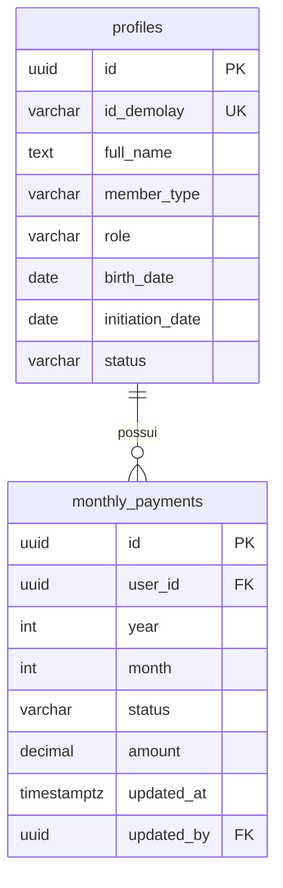
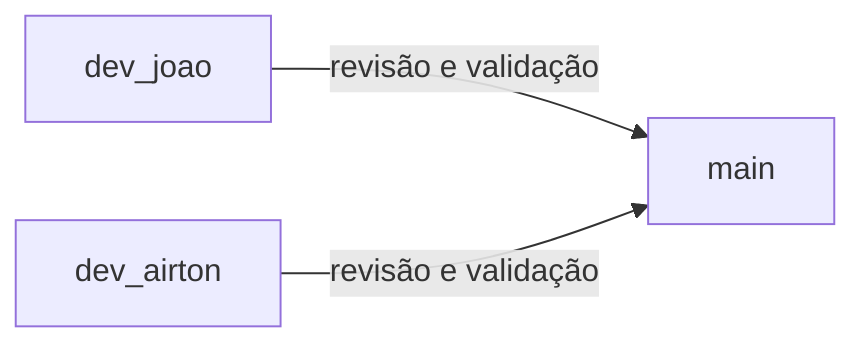

<div align="center">

# Capítulo Professor Carvalho Neves Nº 500

### Portal institucional e sistema integrado de gestão

Plataforma digital para apresentar a história do Capítulo, aproximar a comunidade e apoiar suas atividades administrativas.

<br>


<br>

[Sobre](#sobre-o-projeto) · [Identidade visual](#identidade-visual-e-experiência) · [Funcionalidades](#funcionalidades) · [Permissões](#perfis-e-permissões) · [Tecnologias](#tecnologias) · [Arquitetura](#arquitetura-da-aplicação) · [Banco de dados](#banco-de-dados) · [Gestões](#padronização-das-gestões) · [Equipe](#equipe-e-colaboração)

</div>

---

## Sobre o projeto

O **Capítulo Professor Carvalho Neves Nº 500** está desenvolvendo uma plataforma web que reúne sua presença institucional e ferramentas de gestão em um único ambiente.

<table>
  <tr>
    <td width="50%" valign="top">
      <h3>Portal público</h3>
      Site institucional aberto à comunidade, pais, responsáveis e possíveis candidatos.
    </td>
    <td width="50%" valign="top">
      <h3>Sistema interno</h3>
      Área autenticada para apoiar as rotinas administrativas, financeiras e secretariais do Capítulo.
    </td>
  </tr>
</table>

O sistema interno adota o modelo **RBAC (Role-Based Access Control)**: as permissões são definidas pela função de cada usuário.

### Princípios do projeto

- **Acesso por função:** cada usuário vê e altera apenas o que sua responsabilidade exige.
- **Dados protegidos no banco:** isolamento com Row Level Security (RLS) no PostgreSQL.
- **Rastreabilidade:** alterações financeiras registram responsável, data e horário.
- **Privacidade:** a galeria pública prioriza insígnias oficiais dos cargos em vez de dados pessoais.
- **Acessibilidade:** contraste adequado, navegação por teclado, foco visível e respeito a `prefers-reduced-motion`.

---

## Identidade visual e experiência

A interface terá identidade própria, reconhecível e consistente com o Capítulo, utilizando exclusivamente a paleta institucional oficial: verde acinzentado, verde oliva, amarelo e azul escuro. O design será contemporâneo, com tipografia bem trabalhada, imagens em destaque, transparências e microinterações, sem reproduzir a identidade visual de outros sites.

| Ambiente | Linguagem |
|---|---|
| **Portal público** | Institucional, acolhedora e histórica, com composição editorial, fotografias e predominância do verde acinzentado (#1F4021), apoiado pelo verde oliva (#636347) e pelo amarelo (#E5AB38). |
| **Área restrita** | Tecnológica e funcional, com dashboard moderno, painéis translúcidos e Glassmorphism aplicado com moderação, usando o verde acinzentado e o azul escuro (#1E3D58) como bases. |

### Paleta institucional

| | Cor oficial | Código | Aplicação sugerida |
|:-:|---|---|---|
|  | **Verde acinzentado** | `#1F4021` | Cor de identidade predominante, fundos institucionais e elementos principais. |
|  | **Verde oliva** | `#636347` | Superfícies secundárias, áreas de apoio e variações de fundo. |
|  | **Amarelo** | `#E5AB38` | Destaques, chamadas para ação, ícones e detalhes de interface. |
|  | **Azul escuro** | `#1E3D58` | Contraste, navegação secundária e elementos de profundidade. |

> [!IMPORTANT]
> O brasão oficial deve ser preservado: não redesenhar, distorcer, recolorir ou substituir seus elementos. Os quatro códigos apresentados na paleta são as referências oficiais da identidade visual do Capítulo; não substituir por tons aproximados.

<details>
<summary><b>Direção visual do portal público</b></summary>

<br>

O portal deve transmitir tradição, fraternidade e continuidade histórica com uma apresentação moderna.

- **Cabeçalho:** navegação limpa, brasão original, nome do Capítulo e acesso à área restrita.
- **Destaque inicial (hero):** seção ampla com fotografia institucional, título marcante e chamada para conhecer o Capítulo.
- **História:** linha do tempo visual com datas, gestões e acontecimentos relevantes.
- **Ordem DeMolay:** conteúdo institucional organizado em seções de leitura agradável.
- **Gestões:** cartões com identificação da gestão, período e fotografia ou composição visual correspondente.
- **Galeria:** imagens em grade responsiva, com visualização ampliada.
- **Notícias e atividades:** cartões editoriais para registros e novidades.
- **Contato:** seção objetiva com canais de comunicação.
- **Rodapé:** identificação institucional, navegação complementar e informações relevantes.

A composição alterna fundos em verde acinzentado (#1F4021) e superfícies claras, com verde oliva (#636347), amarelo (#E5AB38) e azul escuro (#1E3D58) aplicados de forma equilibrada. Fotografias reais do Capítulo têm destaque, sem excesso de elementos decorativos.

</details>

<details>
<summary><b>Direção visual da área restrita</b></summary>

<br>

Linguagem de dashboard SaaS, mais tecnológica e voltada à produtividade. O conceito principal é o **Glassmorphism**: painéis com transparência, desfoque de fundo, bordas sutis e iluminação discreta, sem prejudicar a leitura.

- **Plano de fundo:** tons escuros derivados do verde acinzentado (#1F4021), com gradientes suaves e pontos de contraste em azul escuro (#1E3D58).
- **Menu lateral:** navegação persistente, ícones consistentes e indicação clara da seção ativa.
- **Cabeçalho do painel:** título da página, identificação do usuário e ações rápidas.
- **Cards de indicadores:** números em destaque, descrições curtas e ícones; verde oliva (#636347) e amarelo (#E5AB38) funcionam como cores de apoio.
- **Painéis:** superfícies translúcidas com `backdrop-filter`, bordas discretas e contraste adequado.
- **Gráficos:** visualizações limpas para frequência, movimentação financeira e indicadores administrativos.
- **Tabelas:** leitura objetiva, filtros, busca e estados visuais para registros.
- **Formulários:** campos consistentes, validação clara e mensagens de retorno.
- **Responsividade:** menu adaptável para telas menores, sem perda de funcionalidades.

O Glassmorphism é mais presente no painel administrativo. Tabelas, formulários e conteúdos densos priorizam a legibilidade.

</details>

<details>
<summary><b>Componentes e interações</b></summary>

<br>

| Componente | Diretriz |
|---|---|
| **Botões** | Estados de hover, foco, carregamento e desabilitado; verde como ação principal. |
| **Cards** | Cantos discretamente arredondados, espaçamento consistente e bordas suaves. |
| **Navegação** | Estado ativo evidente, ícones Lucide e comportamento responsivo. |
| **Modais** | Fundo sobreposto, hierarquia clara e fechamento acessível. |
| **Notificações** | Mensagens objetivas para sucesso, erro e confirmação. |
| **Gráficos** | Legendas, unidades e informações acessíveis, sem excesso de efeitos. |
| **Animações** | Transições curtas e suaves em entradas, menus e interações. |

</details>

<details>
<summary><b>Responsividade e mobile</b> · planejado</summary>

<br>

A adaptação completa para dispositivos móveis está prevista para uma etapa futura do desenvolvimento. Diretrizes já definidas:

- Abordagem mobile-first com Tailwind CSS: estilos base para telas pequenas, ampliados por breakpoints.
- Menu lateral do painel como gaveta ou barra inferior em telas menores.
- Tabelas extensas como cartões empilhados ou com rolagem horizontal contida no próprio componente.
- Alvos de toque com no mínimo 44 px.
- Rotinas de uso frequente no celular, como chamada digital e consulta de pagamentos, com fluxo de toque único.
- Efeitos de Glassmorphism limitados a poucos elementos, pelo custo de `backdrop-filter` em aparelhos mais simples.
- Validação em dispositivos reais, além do modo responsivo do navegador.

</details>

---

## Funcionalidades

### Portal público

| Página | O que oferece |
|---|---|
| **Início** | Apresentação institucional, atividades recentes e chamada para novos candidatos. |
| **História** | Biografia do patrono, Prof. Carvalho Neves, e marcos históricos do Capítulo. |
| **Ordem DeMolay** | Princípios, Sete Virtudes Cardeais, requisitos de ingresso e informações institucionais. |
| **Galeria de gestões** | Histórico das gestões com insígnias oficiais dos cargos, priorizando a privacidade dos membros. |
| **Contato** | Formulário para envio de mensagens ao Mestre Conselheiro (MC) e ao Presidente do Conselho Consultivo (PCC). |

### Área restrita

Ambiente autenticado destinado aos membros autorizados, com módulos específicos para cada responsabilidade.

<details>
<summary><b>Painel Master / Admin</b> · Mestre Conselheiro e Presidente do Conselho Consultivo</summary>

<br>

- Gestão global de usuários, cargos, permissões e módulos.
- Alternador **"Ver como Membro"**, para visualizar a interface de um membro comum sem encerrar a sessão administrativa.
- Indicadores gerais de frequência e sessões do ano.
- Calendário de eventos e ranking de assiduidade.
- Fila de moderação de mídias, relatos e publicações do portal.
- Gestão do acervo de documentos oficiais, como regimento interno, atas e planejamento anual.

</details>

<details>
<summary><b>Tesouraria</b></summary>

<br>

- Busca de membros por nome ou ID.
- Consulta individual de débitos e parcelas pendentes.
- Matriz de mensalidades por membro e mês, com os estados **Pago**, **Pendente** e **Isento**.
- Configuração dos valores de mensalidade por categoria.
- Regras de cobrança considerando a data de iniciação e a transição para Sênior aos 21 anos.
- Emissão de comprovantes de quitação em PDF, com hash de verificação de autenticidade.
- Registro de auditoria das alterações financeiras, identificando responsável, data e horário.

</details>

<details>
<summary><b>Secretaria e frequência</b></summary>

<br>

- Registro digital de presença em sessões ordinárias e extraordinárias.
- Registro de frequência presencial ou justificada.
- Consulta de assiduidade por membro, com ID, cargo e percentual.
- Cálculo de elegibilidade conforme os critérios definidos para voto e candidatura a cargos eletivos.
- Redação, publicação e armazenamento de atas.

</details>

<details>
<summary><b>Quadro de membros</b></summary>

<br>

- Cadastro com ID, nome completo, categoria, data de nascimento e data de iniciação.
- Edição de dados cadastrais.
- Inativação de membros com registro da justificativa.
- Preservação do histórico financeiro e de frequência após a inativação.

</details>

<details>
<summary><b>Perfil do membro</b></summary>

<br>

- Consulta ao histórico individual de presença.
- Consulta ao extrato financeiro pessoal.
- Contagem regressiva para a maioridade DeMolay, com alerta de transição para Sênior.
- Download do próprio comprovante de quitação em PDF.

</details>

---

## Perfis e permissões

O controle de acesso é organizado em quatro perfis, associados às responsabilidades de cada cargo.

| Perfil | Cargos / usuários | Permissões principais |
|---|---|---|
| **Master / Admin** | Mestre Conselheiro e Presidente do Conselho Consultivo | Todos os módulos, alternador "Ver como Membro", moderação de mídias, gestão de usuários e auditoria global. |
| **Tesouraria** | Tesoureiro e Tesoureiro Adjunto | Dashboard financeiro, busca de membros, baixa manual de mensalidades, recibos em PDF e alteração de taxas. |
| **Secretaria** | Escrivão | Chamada digital, cálculo de assiduidade e elegibilidade, publicação de atas e gestão cadastral. |
| **Membro / Consultor** | DeMolays Ativos, Maçons e Seniores | Consulta ao próprio histórico de frequência e mensalidades, download do próprio recibo e acesso ao acervo público. |

---

## Tecnologias

| Camada | Tecnologias |
|---|---|
| **Frontend** | Next.js, React, Tailwind CSS e Lucide React |
| **Animações** | Framer Motion |
| **Gráficos** | Recharts |
| **Backend e autenticação** | Supabase e Supabase Auth |
| **Banco de dados** | PostgreSQL |
| **Segurança de dados** | Row Level Security (RLS) |
| **Armazenamento** | Supabase Storage |
| **Documentos PDF** | jspdf e html2pdf.js |
| **Hospedagem** | Vercel (frontend) e Supabase Cloud (backend e banco de dados) |

> [!NOTE]
> Framer Motion e Recharts fazem parte da direção técnica prevista para as animações e visualizações do painel. Devem ser adicionados às dependências do projeto quando esses componentes forem implementados.

---

## Arquitetura da aplicação

```mermaid
flowchart LR
    subgraph PUB["Portal Público"]
        direction TB
        P1["Início"]
        P2["História"]
        P3["Ordem DeMolay"]
        P4["Galeria de Gestões"]
        P5["Notícias e Atividades"]
        P6["Contato"]
    end

    subgraph RES["Área Restrita"]
        direction TB
        R1["Painel Master / Admin"]
        R2["Módulo da Tesouraria"]
        R3["Módulo da Secretaria"]
        R4["Quadro de Membros"]
        R5["Perfil do Membro"]
    end

    PUB --> AUTH["Supabase Auth"]
    AUTH --> RES
    RES --> DB[("PostgreSQL + RLS")]
```



---

## Banco de dados

O banco utiliza **PostgreSQL**, disponibilizado pelo Supabase. O esquema inicial contempla duas estruturas principais:

- **`profiles`:** dados cadastrais, identificação e nível de acesso dos usuários.
- **`monthly_payments`:** registros de mensalidades, com competência, valor, situação e responsável pela última atualização.



<details>
<summary><b>Esquema SQL inicial</b></summary>

<br>

```sql
CREATE TABLE profiles (
  id UUID PRIMARY KEY REFERENCES auth.users(id),
  id_demolay VARCHAR(20) UNIQUE NOT NULL,
  full_name TEXT NOT NULL,

  member_type VARCHAR(20)
    CHECK (member_type IN ('demolay', 'macom')),

  role VARCHAR(20)
    CHECK (role IN ('master', 'tesoureiro', 'escrivao', 'membro')),

  birth_date DATE NOT NULL,
  initiation_date DATE NOT NULL,

  status VARCHAR(20) DEFAULT 'ativo'
    CHECK (status IN ('ativo', 'desligado', 'senior'))
);

CREATE TABLE monthly_payments (
  id UUID PRIMARY KEY DEFAULT gen_random_uuid(),
  user_id UUID REFERENCES profiles(id),

  year INT NOT NULL,
  month INT CHECK (month BETWEEN 1 AND 12),

  status VARCHAR(20)
    CHECK (status IN ('pago', 'pendente', 'isento')),

  amount DECIMAL(10,2),

  updated_at TIMESTAMP WITH TIME ZONE DEFAULT NOW(),
  updated_by UUID REFERENCES profiles(id)
);
```

</details>

> [!NOTE]
> Este é o esquema inicial. As políticas de Row Level Security (RLS), as validações e as demais tabelas serão definidas e implementadas conforme a evolução dos módulos.

---

## Status do desenvolvimento

- [x] Esquema SQL inicial (`profiles` e `monthly_payments`)
- [ ] Políticas de Row Level Security
- [ ] Demais tabelas e validações
- [ ] Portal público
- [ ] Painel Master / Admin
- [ ] Módulo da Tesouraria
- [ ] Módulo da Secretaria e frequência
- [ ] Quadro de membros e perfil do membro
- [ ] Adaptação para dispositivos móveis (planejada)

---

## Padronização das gestões

Todas as referências às gestões no sistema, na galeria, nos documentos e nas atas seguem o padrão:

```text
Gestão [Algarismo Romano] — MC [Nome Completo] ([Ano].[Semestre])
```

Exemplo: **Gestão XXIII — MC João Guilherme Martins Lopes Monteiro (2025.2)**

<details>
<summary><b>Histórico de gestões</b> · I a XXV (2012 a 2026)</summary>

<br>

| Gestão | Mestre Conselheiro | Período |
|:---:|---|:---:|
| I / II | Tiago Moreira | 2012.1 / 2012.2 |
| III | Diógenes Quaresma | 2013.1 |
| IV | Arthur Cerqueira | 2013.2 |
| V | Victor Barros | 2014.1 |
| VI | Marcelo Negreiros Júnior | 2014.2 |
| VII | Renandro Reis | 2015.1 |
| VIII | Itamar Filho | 2015.2 |
| IX | Ericles Guerra | 2016.1 |
| X | Cleilson Almeida | 2016.2 |
| XI | Breno Correia | 2017.1 |
| XII | Rafael Rocha | 2017.2 |
| XIII | Ezequias Júnior | 2018.1 |
| XIV | Tomaz Neto | 2018.2 |
| XV | Gustavo Vilarinho | 2019.1 |
| XVI | Vinícius Linhares | 2019.2 |
| XVII | Gabriel Dias | 2020.1 |
| XVIII | Wesley de Sousa Pinheiro de Abreu | 2023.1 |
| XIX | Caio Carvalho Fonseca Lima | 2023.2 |
| XX | Wesley de Sousa Pinheiro de Abreu | 2024.1 |
| XXI | Fábio Anicácio Brito Correia | 2024.2 |
| XXII | Epaminondas Coutinho Feitosa Júnior | 2025.1 |
| XXIII | João Guilherme Martins Lopes Monteiro | 2025.2 |
| XXIV | José Keltton Cardoso da Silva Viana | 2026.1 |
| XXV | Rafael Inácio do Nascimento de Morais | 2026.2 |
| XXVI | João Guilherme Martins Lopes Monteiro | 2027.1 |

</details>

---

## Equipe e colaboração

### Desenvolvedores

| Desenvolvedor | Atuação |
|---|---|
| **João Guilherme** | Desenvolvedor Full Stack |
| **Airton** | Desenvolvedor Full Stack |

### Fluxo de branches

O repositório separa o desenvolvimento individual da versão estável. As funcionalidades nascem nas branches individuais e entram na `main` após revisão e validação.



| Branch | Responsável / finalidade |
|---|---|
| **`main`** | Versão estável de produção. |
| **`dev_joao`** | Ambiente de desenvolvimento de João Guilherme. |
| **`dev_airton`** | Ambiente de desenvolvimento de Airton. |

---

<div align="center">

**Capítulo Professor Carvalho Neves Nº 500**

Portal institucional e sistema integrado de gestão

</div>
