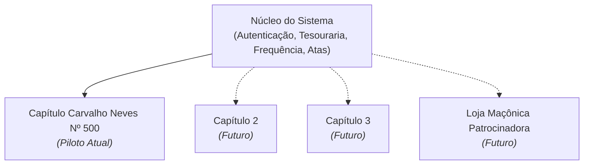

# 01 - Visão Geral e Estratégia

## 1. O que é o projeto?

O **Sistema Carvalho Neves** é uma plataforma web unificada que resolve duas necessidades essenciais do Capítulo:

1. **Presença Pública (Portal):** Apresentar a história do Capítulo, as 7 virtudes da Ordem DeMolay, a galeria de gestões e canais de contato para novos membros e familiares.
2. **Gestão Interna (Painel Administrativo):** Centralizar tesouraria (mensalidades), secretaria (chamada e atas), cadastro de membros e controle de frequência em um único sistema seguro e moderno.

---

## 2. Por que o Carvalho Neves Nº 500 é o Piloto?

> [!IMPORTANT]
> **O Capítulo Carvalho Neves Nº 500 é a nossa base de referência (MVP / Piloto).**

Desenvolver primeiro focado no CN Nº 500 é uma escolha estratégica pelas seguintes razões:
- **Regras Reais de Validação:** Testamos os fluxos reais de um capítulo (pagamento de mensalidades, idade limite de 21 anos, elegibilidade de votos para escrivão/tesoureiro/MC) diretamente na rotina do capítulo.
- **Ciclo Rápido de Feedback:** A diretoria e os membros usam o sistema no dia a dia, apontando melhorias práticas antes de abrirmos para terceiros.

---

## 3. Como essa base escala para Outros Capítulos?

A arquitetura foi pensada desde a primeira linha de código para ser **multi-tenant (multi-capítulos)** no futuro:

### O que garante essa escalabilidade:
- **Regras de negócio isoladas (`modules/`):** O código das regras não fica preso nas páginas; fica em módulos reaproveitáveis.
- **Banco preparado para `chapter_id`:** O schema de dados canônico foi desenhado para aceitar uma coluna de identificador de capítulo no futuro, isolando os dados de cada entidade via Row Level Security (RLS).
- **Temas flexíveis:** As cores e o brasão são tratados como variáveis, permitindo que cada capítulo tenha sua própria identidade visual sem mudar a engenharia do software.
