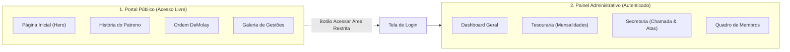

# 02 - Arquitetura Técnica e Pastas

## 1. Dois Mundos em Uma Única Aplicação

O projeto utiliza **Next.js 16 (App Router)** e separa claramente o lado público do lado privado:



---

## 2. Mapa de Pastas do Código (`site-cn`)

A estrutura segue o padrão profissional de organização por escopo:

```text
site-cn/
├── app/
│   ├── (public)/                 # Páginas abertas ao público
│   │   ├── page.tsx              # Página inicial institucional
│   │   ├── historia/page.tsx     # História e marcos
│   │   ├── demolay/page.tsx      # Ordem DeMolay e virtudes
│   │   └── gestoes/page.tsx      # Histórico de gestões
│   │
│   ├── (auth)/                   # Fluxos de acesso
│   │   └── login/page.tsx        # Login individual
│   │
│   ├── (dashboard)/              # Módulos privados do painel
│   │   ├── dashboard/page.tsx    # Visão geral e métricas
│   │   ├── tesouraria/page.tsx   # Controle financeiro
│   │   ├── secretaria/page.tsx   # Chamada e frequência
│   │   └── membros/page.tsx      # Cadastro de membros
│   │
│   ├── globals.css               # Estilos globais e tokens de cores
│   └── layout.tsx                # Shell raiz da aplicação
│
├── components/
│   ├── ui/                       # Botões, Cards, Inputs, Modais
│   ├── site/                     # Cabeçalho, Rodapé e Seções públicas
│   └── dashboard/                # Sidebar e cards de indicadores
│
├── lib/
│   └── supabase/                 # Conexão segura cliente e servidor
│
└── types/                        # Definições TypeScript
```

---

## 3. Tecnologias Utilizadas

| Camada | Tecnologia | Função |
|---|---|---|
| **Framework** | Next.js 16 (App Router) + React 19 | Estrutura web moderna e rápida |
| **Estilização** | Tailwind CSS v4 | Design responsivo baseado em tokens |
| **Banco de Dados** | PostgreSQL (Supabase) | Armazenamento relacional robusto |
| **Segurança** | Row Level Security (RLS) | Proteção de dados direto no banco |
| **Ícones** | Lucide React | Ícones limpos e consistentes |
