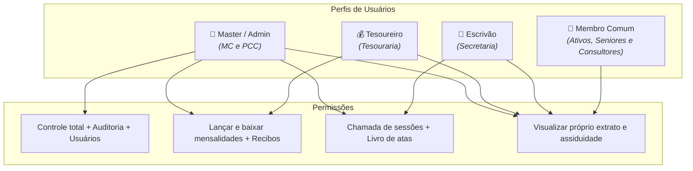
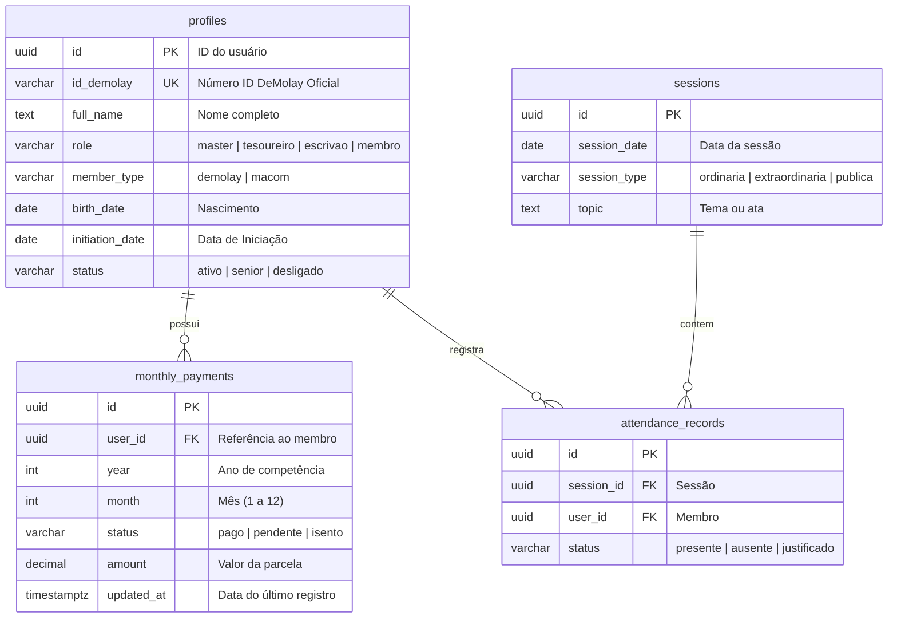

# 03 - Banco de Dados e Acessos (RBAC)

## 1. Níveis de Acesso (RBAC)

Cada usuário autenticado possui uma função (`role`) no sistema que determina o que ele pode visualizar ou alterar:

---

## 2. Estrutura das Tabelas (Schema Inicial)

---

## 3. Segurança dos Dados (Row Level Security - RLS)

- Ninguém acessa os dados de outro membro a menos que seu perfil permita.
- O membro comum só consegue consultar as suas próprias linhas na tabela de mensalidades e presenças.
- Apenas usuários com `role = 'tesoureiro'` ou `'master'` podem atualizar o status de pagamentos.
