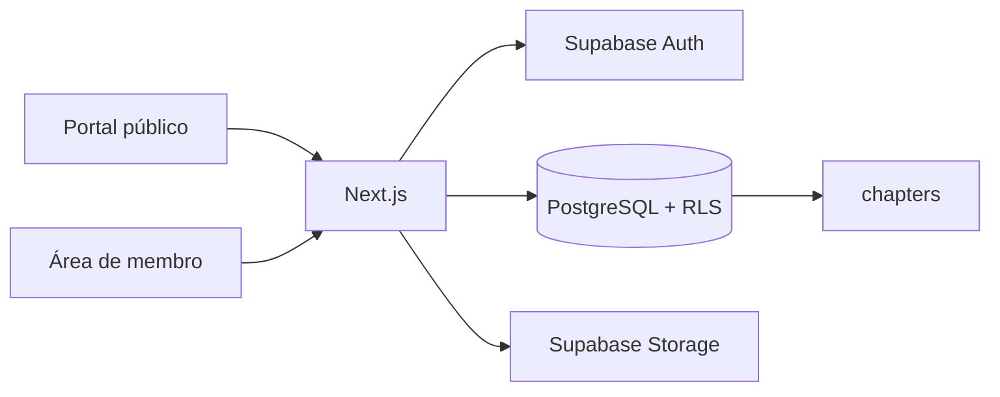

# Arquitetura do Sistema CN

O Sistema CN é uma aplicação Next.js hospedada na Vercel, com Supabase para Auth, PostgreSQL, Storage e RLS. Cada dado institucional é associado a `chapters`, permitindo expansão para outros Capítulos sem mistura de dados.

## Segurança

- A interface nunca usa `service_role`.
- Acesso a `/dashboard` exige sessão no `proxy.ts`.
- O banco aplica RLS; a ausência de uma política significa negação de acesso.
- O papel é atribuído por vínculo em `chapter_memberships`, nunca globalmente.

## Convenções

- Migrations: `supabase/migrations/`.
- Arquivos privados: URLs assinadas, geradas apenas pelo servidor.
- Exclusão lógica: `deleted_at` quando o histórico precisa ser preservado.
