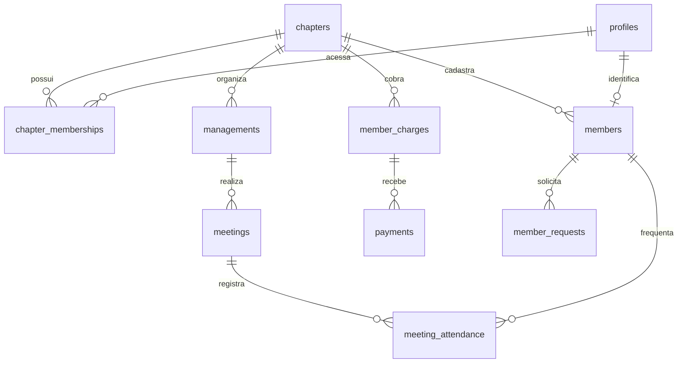

# Banco de dados e Storage

A migration `20261109000000_cn_core.sql` cria a fundação incremental do sistema. Ela não contém `DROP`, `TRUNCATE` nem reset.

## Grupos de tabelas

| Domínio | Tabelas |
|---|---|
| Instituição e acesso | `chapters`, `chapter_settings`, `profiles`, `chapter_memberships`, `user_roles`, `permission_definitions`, `role_permissions` |
| Pessoas e gestões | `members`, históricos de status/graus/cargos, `managements`, posições e nominatas |
| Secretaria | documentos, reuniões, pautas, atas, frequência, justificativas, mídia e tarefas |
| Financeiro | contas, categorias, períodos, taxas, cobranças, pagamentos, comprovantes, transações, relatórios e auditoria |
| Atendimento | solicitações, mensagens, anexos e histórico |
| Plataforma | notificações, auditoria, histórico de login e eventos de segurança |

## RLS e Storage

RLS é ativado para todas as tabelas. Políticas explicitamente criadas cobrem capítulos públicos, perfil próprio, vínculo próprio, membros, reuniões, frequência, solicitações e notificações. Tabelas sem política permanecem inacessíveis pelo cliente até que a rota de servidor e a política específica sejam implementadas.

Buckets: `brasao`, `gestoes`, `atividades` (públicos); `membros`, `documentos`, `comprovantes`, `solicitacoes`, `declaracoes` (privados).
